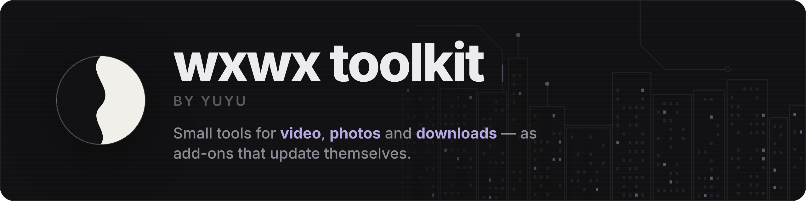
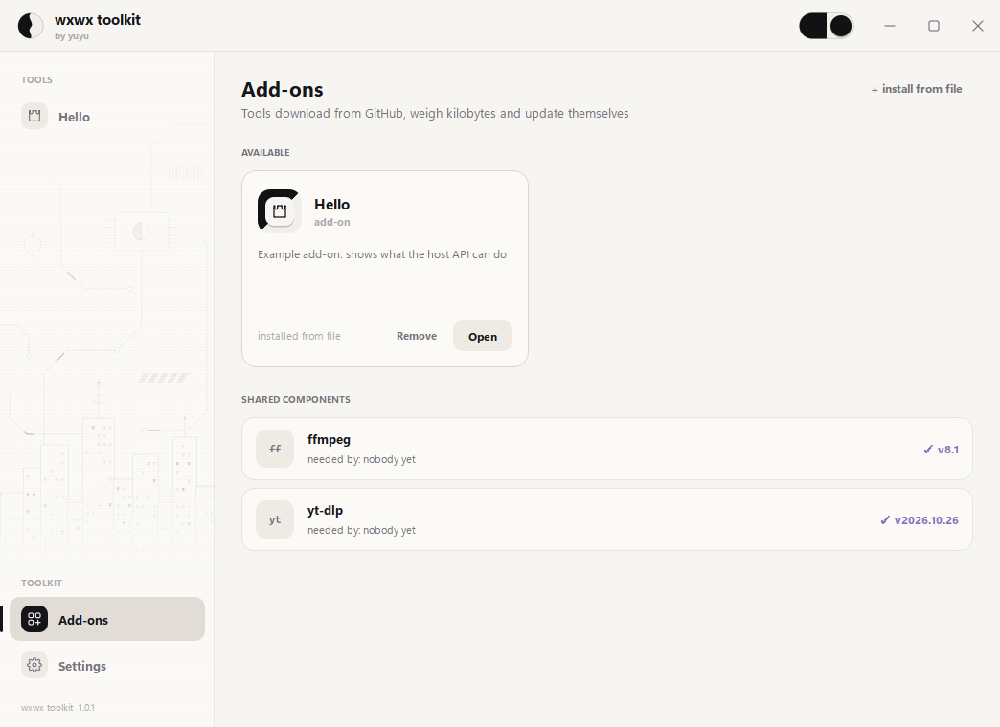
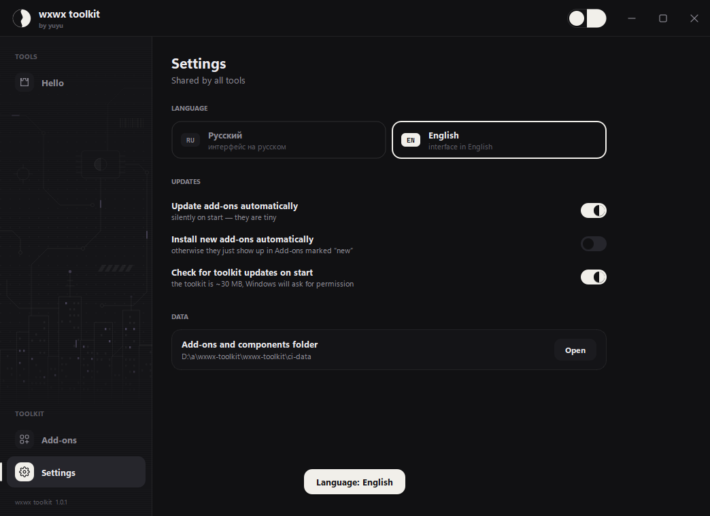

<p align="center">
  <picture>
    <source media="(prefers-color-scheme: dark)" srcset="docs/images/banner-dark.png">
    <source media="(prefers-color-scheme: light)" srcset="docs/images/banner-light.png">
    
  </picture>
</p>

<p align="center">
  <b>English</b> · <a href="README.ru.md">Русский</a>
</p>

<p align="center">
  <a href="https://github.com/ddam1k/wxwx-toolkit/releases/latest"></a>
  <a href="https://github.com/ddam1k/wxwx-toolkit/releases"></a>
  
  <a href="LICENSE"></a>
</p>

<p align="center">
  <a href="https://github.com/ddam1k/wxwx-toolkit/releases/latest/download/wxwx-toolkit-setup.exe">
    
  </a>
</p>

---

**wxwx toolkit** is a home for small everyday tools: compressing video, shrinking photos,
downloading reference videos and whatever comes next. Every tool is an **add-on**: it downloads from
GitHub in a second, weighs a few kilobytes and keeps itself up to date.

## ✦ Features

- **Add-on store.** New tools show up by themselves, marked *new*. Installed ones update silently on start.
- **Shared tools, downloaded once.** ffmpeg and yt-dlp are fetched on first need and shared by every add-on.
- **Black & white.** Dark and light themes, switched with a circular reveal.
- **Russian & English** interface, switchable on the fly.
- **Updates itself.** When a new version is out, a bar appears at the top: one click and it reinstalls and restarts.
- **Feels native.** One combined title bar, but moving, resizing, Win+arrows and the window shadow all work as usual.

## ✦ Screenshots

<p align="center">
  
  
</p>

## ✦ Install

1. Download **[wxwx-toolkit-setup.exe](https://github.com/ddam1k/wxwx-toolkit/releases/latest/download/wxwx-toolkit-setup.exe)** and run it.
   It installs for your user without admin rights (to `%LOCALAPPDATA%\Programs\wxwx toolkit`); you can pick any other folder.
2. The app isn't code-signed, so Windows may say *"Windows protected your PC"*.
   Click **More info → Run anyway**.

Prefer no installer? Grab `wxwx-toolkit-X.Y.Z-portable.zip` from [Releases](https://github.com/ddam1k/wxwx-toolkit/releases/latest)
(the portable version doesn't update itself).

Settings, add-ons and shared tools live next to the program in the `data` folder, so the whole toolkit is one folder. They survive updates; when you uninstall, you're asked whether to delete them.

## ✦ Add-ons

Open **Add-ons** in the left menu and press **Install**. The tool appears in the menu right away.

Want to build your own? Read **[docs/ADDONS.md](docs/ADDONS.md)**: an add-on is a zip with a manifest and
one Python function that returns a widget. A working example lives in [examples/hello-addon](examples/hello-addon).

## ✦ For developers

```
run.bat                                   run from source
build.bat                                 build dist\wxwx-toolkit\wxwx-toolkit.exe
python -m unittest discover -s tests      tests
```

**Releasing:** bump `__version__` in `wxwx_toolkit/__init__.py`, add a section to [CHANGELOG.md](CHANGELOG.md),
push, then **Actions → build → Run workflow → ☑ release**. CI runs the tests, downloads ffmpeg & yt-dlp,
starts the real UI with the example add-on, builds the exe and installer, checks install → update → uninstall
and publishes the release with notes from the changelog.

<details>
<summary>Project layout</summary>

```
wxwx_toolkit/
  core/addons.py       catalog, install / remove / load add-ons
  core/components.py   shared ffmpeg / yt-dlp
  core/updater.py      self-update
  core/i18n.py         Russian / English strings
  ui/main_window.py    window and logic
  ui/titlebar.py       combined title bar
  ui/shell.py          sidebar with the cyberpunk background, nav, switches
  ui/pages.py          Add-ons, Settings, add-on error page
  ui/host.py           the API an add-on receives
addons.json            the add-on catalog
```
</details>

## ✦ License

[MIT](LICENSE) © yuyu. Third-party components and their licenses: [THIRD_PARTY_NOTICES.md](THIRD_PARTY_NOTICES.md).
