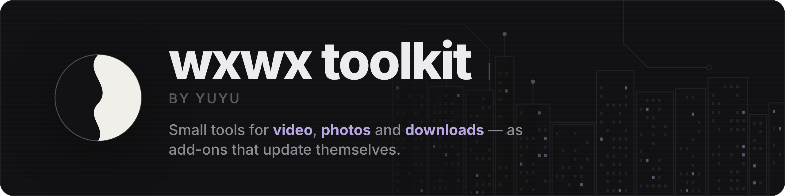
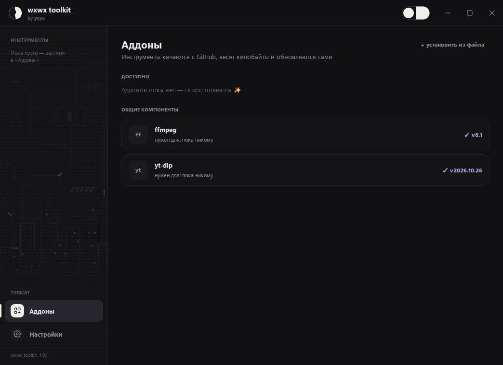
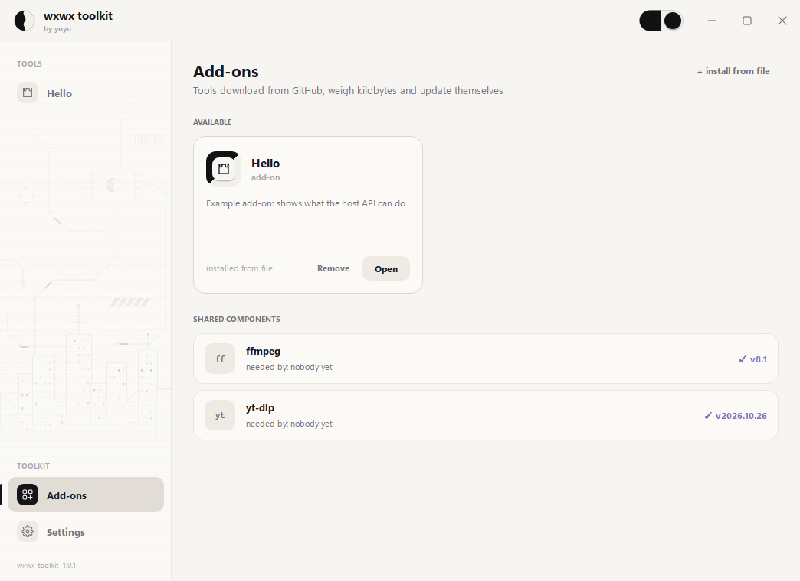

<p align="center">
  <picture>
    <source media="(prefers-color-scheme: dark)" srcset="docs/images/banner-dark.png">
    <source media="(prefers-color-scheme: light)" srcset="docs/images/banner-light.png">
    
  </picture>
</p>

<p align="center">
  <a href="README.md">English</a> · <b>Русский</b>
</p>

<p align="center">
  <a href="https://github.com/ddam1k/wxwx-toolkit/releases/latest"></a>
  <a href="https://github.com/ddam1k/wxwx-toolkit/releases"></a>
  
  <a href="LICENSE"></a>
</p>

<p align="center">
  <a href="https://github.com/ddam1k/wxwx-toolkit/releases/latest/download/wxwx-toolkit-setup.exe">
    
  </a>
</p>

---

**wxwx toolkit** — дом для маленьких повседневных инструментов: сжать видео, ужать фото, скачать
референсы с YouTube и всё, что появится дальше. Каждый инструмент — это **аддон**: он скачивается
с GitHub за секунду, весит килобайты и сам обновляется.

## ✦ Что умеет

- **Магазин аддонов.** Новые инструменты появляются сами с меткой «новое», установленные тихо обновляются при запуске.
- **Общие программы качаются один раз.** ffmpeg и yt-dlp скачиваются, когда впервые понадобятся, и общие для всех аддонов.
- **Чёрное и белое.** Тёмная и светлая тема, переключаются кругом.
- **Русский и английский** интерфейс, переключается на лету.
- **Сам обновляется.** Когда выходит новая версия, сверху появляется плашка: один клик — и тулкит переустановится и перезапустится.
- **Ведёт себя как родное окно.** Одна общая полоса заголовка, но перетаскивание, растягивание, Win+стрелки и тень работают как обычно.

## ✦ Скриншоты

<p align="center">
  
  
</p>

## ✦ Установка

1. Скачай **[wxwx-toolkit-setup.exe](https://github.com/ddam1k/wxwx-toolkit/releases/latest/download/wxwx-toolkit-setup.exe)** и запусти.
   По умолчанию ставится в `C:\Program Files\wxwx toolkit`, папку можно выбрать.
2. Программа без цифровой подписи, поэтому Windows может показать «Windows защитила ваш компьютер».
   Нажми **«Подробнее» → «Выполнить в любом случае»**.

Без установки: `wxwx-toolkit-X.Y.Z-portable.zip` из [Releases](https://github.com/ddam1k/wxwx-toolkit/releases/latest)
(portable-версия сама не обновляется).

Аддоны и общие программы лежат в `%LOCALAPPDATA%\wxwx-toolkit`: переживают обновления и не требуют прав администратора.

## ✦ Аддоны

Открой **«Аддоны»** в левом меню и нажми **«Установить»** — инструмент сразу появится в меню.

Хочешь сделать свой? Читай **[docs/ADDONS.md](docs/ADDONS.md)**: аддон — это zip с манифестом и одной
Python-функцией, которая возвращает виджет. Рабочий пример — [examples/hello-addon](examples/hello-addon).

## ✦ Разработка

```
run.bat                                   запуск из исходников
build.bat                                 сборка dist\wxwx-toolkit\wxwx-toolkit.exe
python -m unittest discover -s tests      тесты
```

**Выпуск версии:** поднять `__version__` в `wxwx_toolkit/__init__.py`, дописать раздел в [CHANGELOG.md](CHANGELOG.md),
запушить, затем **Actions → build → Run workflow → ☑ release**. CI прогонит тесты, скачает ffmpeg и yt-dlp,
запустит настоящий интерфейс с примером аддона, соберёт exe и установщик, проверит установку → обновление →
удаление и опубликует релиз с текстом из CHANGELOG.

## ✦ Лицензия

[MIT](LICENSE) © yuyu. Сторонние компоненты и их лицензии: [THIRD_PARTY_NOTICES.md](THIRD_PARTY_NOTICES.md).
